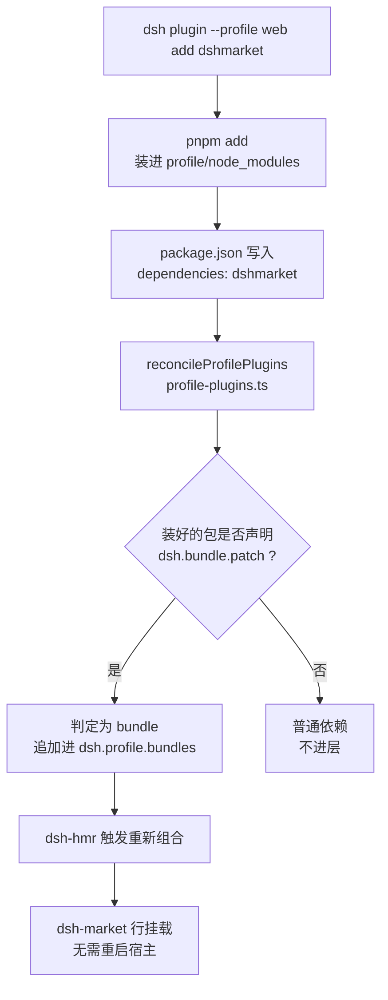
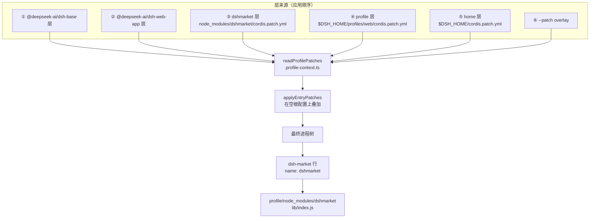
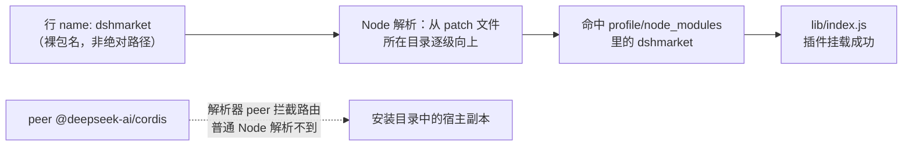

# DSH 插件市场 dshmarket 的加载机制

本机 `web` profile 装了这个社区插件市场。下面记录它是怎么被 DSH 加载的。

问题很具体：

> `$DSH_HOME/cordis.patch.yml` 和 `$DSH_HOME/profiles/web/cordis.patch.yml` 里都没有 dshmarket 的任何字样，DSH 凭什么能用它？

启用声明写在 profile 的 `package.json` 里，挂载动作写在插件包自己随包发布的 `cordis.patch.yml` 里。boot 时 DSH 按 `dsh.profile.bundles` 逐层拼装，用不着手写任何配置。

## 加载流程

链路分两段：安装时把插件声明进层，boot 时把各层合成进程树。

安装：`dsh plugin add` 之后为什么不用手写配置



boot：6 个层如何变成一棵进程树



③ 是 bundle 层，内容随包发布，不在用户配置里。它排在第 3 位，行却落在树尾 —— `insert` 追加的是根列表末尾，跟层序是两回事。

## 环境与路径

路径一律写成可移植形式。下面的例子是本机 `web` profile，换机器或换 profile 时替换对应部分即可。

| 项 | 值 |
| --- | --- |
| dsh 版本 | 0.2.2-rc.1 |
| profile | `web`（`$DSH_HOME/profiles/web`） |
| 插件 | `dshmarket` 1.73.19（npm 包名 `dshmarket`），上游仓库 [`dsh-market/dsh-market`](https://github.com/dsh-market/dsh-market) |
| DSH 源码 | 官方仓库 [`deepseek-ai/deepseek-harness`](https://github.com/deepseek-ai/deepseek-harness)，引用固定在 commit [`fcc0ad46`](https://github.com/deepseek-ai/deepseek-harness/commit/fcc0ad462172522aaf5c93a7b2e01f6b9f0b0159)（0.2.2-rc.1 发布点） |

- `$DSH_HOME` —— Harness 主目录，默认 `~/.dsh`，可用环境变量 `DSH_HOME` 改写；
- DSH 源码引用走 GitHub，固定在 commit `fcc0ad46`，行号锚点始终指向本机跑着的那份代码，不随上游 master 漂移；
- dshmarket 上游引用固定在 tag `v1.73.19`，与本机安装版本对齐；
- profile 名 `web` 是本机实例，换 profile 时把文中 `web` 换成实际名字即可。

## 一、安装时：依赖如何自动进层

`dsh plugin add` 只做两件事：把包装进 profile，再把 bundle 声明追加进 profile 清单。

启用声明记在 `$DSH_HOME/profiles/web/package.json`，不在任何 patch 文件里：

```json
{
  "name": "dsh-profile-web",
  "private": true,
  "dependencies": {
    "dshmarket": "^1.73.19"
  },
  "dsh": {
    "profile": {
      "bundles": [
        "@deepseek-ai/dsh-base",
        "@deepseek-ai/dsh-web-app",
        "dshmarket"
      ]
    }
  }
}
```

这一行就是启用开关，由 `dsh plugin add` 自动写入。写入逻辑在 [`packages/boot/app-boot/src/profile-plugins.ts`](https://github.com/deepseek-ai/deepseek-harness/blob/fcc0ad462172522aaf5c93a7b2e01f6b9f0b0159/packages/boot/app-boot/src/profile-plugins.ts#L104) 的 `reconcileProfilePlugins`：

1. pnpm 把包装进 profile 的 `node_modules`，写进 `dependencies`；
2. 随后扫描 `dependencies`，发现某个依赖的 `package.json` 声明了 `dsh.bundle.patch`（即它是一个 bundle）；
3. 把该依赖追加进 `dsh.profile.bundles`，并按声明顺序排在模板 bundle 之后。

装完就生效是 CLI 契约的一部分：依赖即 bundle，bundle 自动进层。卸载时同一个函数会把失去依赖的条目从 `bundles` 里剔掉。

这次安装动了 `$DSH_HOME` 下哪些文件，见[第六节](#六dsh_home-下的文件改动)。

dshmarket 自己的 manifest 是这么声明的（文件为 `package.json`，本机在 `$DSH_HOME/profiles/web/node_modules/dshmarket/package.json`，上游见 [`dsh-market/dsh-market` 的 `package.json`](https://github.com/dsh-market/dsh-market/blob/v1.73.19/package.json#L48-L60)）：

```json
"dsh": {
  "bundle": { "patch": "./cordis.patch.yml" },
  "client": {
    "inject": [
      "@deepseek-ai/dsh-client-locale",
      "@deepseek-ai/dsh-client-ui-settings",
      "@deepseek-ai/dsh-client-ui-theme"
    ],
    "platform": "web"
  }
}
```

## 二、boot 时：6 个层如何合成一棵进程树

[`loadProfileDirectory`](https://github.com/deepseek-ai/deepseek-harness/blob/fcc0ad462172522aaf5c93a7b2e01f6b9f0b0159/packages/boot/app-boot/src/profile.ts#L678) 遍历 `dsh.profile.bundles`，对每个包名做三件事：

```ts
// packages/boot/app-boot/src/profile.ts
const packageDir = resolveBundleDir(binName, packageName, installAnchor, dir)  // :651
const bundle = readProfileManifest(binName, packageDir).dsh?.bundle
const patchPaths = bundlePatchPaths(packageDir, bundle)                          // :69
const patches = patchPaths.flatMap(patchPath => loadOverlayPatches(binName, patchPath))
layers.push({ packageName, packageDir, patchPaths, patches })
```

- `resolveBundleDir`（`profile.ts:651`）按「dsh 安装目录 → profile 目录」两个锚点依次找包目录。官方内置 bundle（`@deepseek-ai/dsh-base` 等）永远从安装目录解析，第三方 bundle 则从 profile 的 `node_modules` 解析。
- `bundlePatchPaths`（`profile.ts:69`）读出该包 manifest 里 `dsh.bundle.patch` 声明的 patch 文件，支持字符串或数组。

每个 bundle 自带一层 patch，内容随包发布，不落在用户配置里。

最终的进程树是这些层依次 apply 到空根配置上得到的，定义在 [`readProfilePatches`](https://github.com/deepseek-ai/deepseek-harness/blob/fcc0ad462172522aaf5c93a7b2e01f6b9f0b0159/packages/boot/app-boot/src/profile-context.ts#L74)：

```ts
const patches = structuredClone([
  ...readBundlePatches(...),                                   // ① 各 bundle 自带层
  ...(initialProfile?.patches ?? loadOptionalPatches(...)),    // ② profile 的 cordis.patch.yml
  ...loadOptionalPatches(binName, join(context.home, ...)),    // ③ home 级 $DSH_HOME/cordis.patch.yml
  ...context.overlays,                                         // ④ --patch overlay
])
```

本机 web profile 的实际顺序：

1. `@deepseek-ai/dsh-base` 层
2. `@deepseek-ai/dsh-web-app` 层
3. `dshmarket` 层
4. `$DSH_HOME/profiles/web/cordis.patch.yml`
5. `$DSH_HOME/cordis.patch.yml`
6. `--patch` overlay

覆盖按行进行：后层改某一行，前面对这一行的改动保留。dshmarket 排在用户层之前，所以用户层仍能覆盖它的配置。

## 三、真正的挂载点：包内自带的 patch

dshmarket 随包发布了这个文件。本机在 `$DSH_HOME/profiles/web/node_modules/dshmarket/cordis.patch.yml`，上游见 [`dsh-market/dsh-market` 的 `cordis.patch.yml`](https://github.com/dsh-market/dsh-market/blob/v1.73.19/cordis.patch.yml#L1-L4)，与已装文件逐字节一致：

```yaml
# dsh bundle patch: inserts this plugin into a profile's layer stack.
- insert:
    - id: dsh-market
      name: 'dshmarket'
```

真正把插件塞进进程树的是这个 `insert`。patch 用 Cordis 的 entry-list 方言：`insert` 往列表追加新行，`id` 是行标识，`name` 是要挂载的模块名。

不带 `id` 的 `insert` 追加到根列表末尾（见 [`vendor/include/src/patch.ts`](https://github.com/deepseek-ai/deepseek-harness/blob/fcc0ad462172522aaf5c93a7b2e01f6b9f0b0159/vendor/include/src/patch.ts#L80) 的 `data.push(...clone)`），带 `id` 则插入该 group 的子项。所以 dshmarket 明明是第 3 层，行却出现在 `--dump-config` 的最后 —— 层序管覆盖关系，行序只管摆放位置。

这里写的是裸包名 `dshmarket`，不是绝对路径。官方参考的说法是「插入行中的相对插件名以各自 patch 文件所在目录解析」：Node 从 patch 文件所在目录逐级向上找，最终命中 profile 的 `node_modules`。

```bash
cd "$DSH_HOME/profiles/web"
node -e "console.log(require('module').createRequire(process.cwd()+'/package.json').resolve('dshmarket'))"
# $DSH_HOME/profiles/web/node_modules/dshmarket/lib/index.js
```

profile 的 `node_modules` 是模块解析的拦截层，见 [`packages/boot/app-boot/src/profile-resolution/resolver.ts`](https://github.com/deepseek-ai/deepseek-harness/blob/fcc0ad462172522aaf5c93a7b2e01f6b9f0b0159/packages/boot/app-boot/src/profile-resolution/resolver.ts#L221) 的 `computeProfileLayer`。

dshmarket 的 peer 依赖（`@deepseek-ai/cordis`、`@deepseek-ai/dsh-settings`）不在 profile 的 `node_modules` 里，同一个解析器会对 peer 做拦截路由，导向安装目录中的宿主副本。用普通 Node 解析不到是正常的，细节见文末。



## 四、热加载与验证

安装与卸载都不需要重启宿主。判断插件是否真的在生效，看合成树和路由即可。

本机 web profile 启用了 `dsh-hmr`，安装后不用重启：

```
include:dsh-market → moduleName: dshmarket → enabled: true → fiberPhase: active
```

HMR 重新组合时会重新 import 之前失败的条目，所以之后装上的依赖同样不用重启就生效。合成树以 `--dump-config` 为准。

① 合成后的真实树

```bash
dsh --profile web --dump-config | grep -A3 'id: dsh-market'
```

每个 bundle 层前都有 `# == <包名>` 标记，dshmarket 层在末尾：

```yaml
# == dshmarket
- id: dsh-market
  name: dshmarket
```

`--dump-default-config` 只打印各 bundle 层；`--dump-config` 再叠加 profile 层、home 层和 `--patch` overlay，并在注释里标明每行出自哪个文件。

② 插件是否在运行中挂载

```bash
# 插件行状态
dsh --profile web --dump-config | grep -B2 -A2 'name: dshmarket'
```

③ 路由是否注册

```bash
# $DSH_WEB_URL 由 dsh web 注入；脱离该环境时回落到默认地址
curl -s -o /dev/null -w '%{http_code}\n' "${DSH_WEB_URL:-http://127.0.0.1:8080}/dsh-market/status"
# 401 —— DSH 登录鉴权拦截；说明路由已挂载（未知路径返回 404）
```

## 五、卸载与回退

```bash
dsh plugin --profile web remove dshmarket
```

`reconcileProfilePlugins` 会把 `dshmarket` 从 `dependencies` 和 `dsh.profile.bundles` 里一并移除，插件随之从合成树消失。

在隔离的 `DSH_HOME` 里跑一遍完整生命周期，不碰线上 profile：

```bash
export VHOME=/tmp/dsh-verify-home
DSH_HOME="$VHOME" dsh plugin --profile web add dshmarket
node -e "const p=require(process.env.VHOME+'/profiles/web/package.json');console.log('装:',p.dsh.profile.bundles,p.dependencies)"
DSH_HOME="$VHOME" dsh plugin --profile web remove dshmarket
node -e "const p=require(process.env.VHOME+'/profiles/web/package.json');console.log('卸:',p.dsh.profile.bundles,p.dependencies)"
```

输出：

```text
装: [ '@deepseek-ai/dsh-base', '@deepseek-ai/dsh-web-app', 'dshmarket' ] { dshmarket: '^1.73.19' }
卸: [ '@deepseek-ai/dsh-base', '@deepseek-ai/dsh-web-app' ] undefined
```

`dsh --profile web --dump-config` 里 `dsh-market` 的出现次数由 1 变 0。

## 六、`$DSH_HOME` 下的文件改动

装一个插件到底动了磁盘上哪些文件。下面的清单来自隔离 `DSH_HOME` 的前后 diff 和本机 profile 的 mtime 交叉验证。

### 要改的文件

| 文件 | 改哪两处 |
| --- | --- |
| `profiles/web/package.json` | `dependencies` 增加 `"dshmarket": "^1.73.19"`；`dsh.profile.bundles` 数组末尾追加 `"dshmarket"` |

改完是这样：

```json
{
  "name": "dsh-profile-web",
  "private": true,
  "dependencies": {
    "dshmarket": "^1.73.19"
  },
  "dsh": {
    "profile": {
      "bundles": [
        "@deepseek-ai/dsh-base",
        "@deepseek-ai/dsh-web-app",
        "dshmarket"
      ]
    }
  }
}
```

### 要新增的文件与目录

| 路径（相对 `$DSH_HOME`） | 内容 |
| --- | --- |
| `profiles/web/node_modules/` | `dshmarket` 及其传递依赖 `argparse`、`js-yaml`、`undici` |
| `profiles/web/pnpm-lock.yaml` | pnpm 锁文件（profile 此前没有这个文件） |
| `profiles/web/.plugin-manager/logs/operation-<id>/pnpm.log` | 本次包管理操作的日志 |

### 完全不用动的文件

| 路径 | 为什么不用动 |
| --- | --- |
| `profiles/web/cordis.patch.yml` | 插件由 bundle 层带入，用户层不需要、也不应该出现 dshmarket 的字样 |
| `profiles/web/cordis.yml` | profile 的空根配置，内容恒为 `[]`，由 boot 流程重写 |
| `$DSH_HOME/cordis.patch.yml` | home 层，承载跨 profile 的通用覆盖，与插件安装无关 |
| 其他 profile 的目录 | 安装只作用于目标 profile；别的 profile（如 `sdk`）要用得各自安装 |

### 手工等价操作

不走 CLI 的话，动手顺序是这样：

```bash
cd "$DSH_HOME/profiles/web"
pnpm add dshmarket     # 写 dependencies + node_modules + pnpm-lock.yaml
# 再手工把 "dshmarket" 追加到 package.json 的 dsh.profile.bundles 末尾
```

CLI 替你完成的是第二步，并且保证顺序：`reconcileProfilePlugins` 把新 bundle 追加在模板 bundle 之后，卸载时再自动剔除。手工维护容易漏掉或写错位置。

### 挂载后产生的文件

这些文件既不在 `$DSH_HOME` 根目录，也不在插件包的安装目录，而在当前 profile 的目录里：

```text
$DSH_HOME/profiles/<profile>/          ← profile 目录（web profile 即 $DSH_HOME/profiles/web）
├── package.json
├── pnpm-lock.yaml
├── cordis.patch.yml
├── node_modules/
│   └── dshmarket/                     ← 插件包本身
├── .plugin-manager/                   ← 宿主侧：包管理操作日志
└── .dsh-market/                       ← 市场侧：插件自己的状态目录（0700）
    ├── state.json
    ├── log.ndjson
    ├── pending-updates.json            （出现「待更新」功能时才生成）
    └── presets.json                    （使用市场预设时才生成）
```

目录位置由 `lib/profile.js` 的 `profileDir()` 决定：

```js
export function profileDir(profile, explicitDir) {
  if (explicitDir !== undefined) return explicitDir;        // ① 配置里显式给了目录就用它
  if (!isDshProfileName(profile)) throw new Error(...);      // ② 否则必须是合法 profile 名
  return join(resolveDshHome(), 'profiles', profile);        // ③ 落到 $DSH_HOME/profiles/<profile>
}
```

profile 目录归 launcher 所有（DSH 通过 `ctx.get('profileContext').dir` 公布），市场只是跟着走。所以每个 profile 各自有一份 `.dsh-market/`，状态互不串味；换 profile 跑 `dsh web`，市场状态就落在那个 profile 的目录里。`$DSH_HOME/cordis.patch.yml` 那种 home 级文件在 `$DSH_HOME` 根上，`.dsh-market/` 是 profile 级，两者层级不同。

确认位置可以从合成树的层注释反查：

```bash
# 从合成树的层注释里反查 profile 目录
dsh --profile web --dump-config | grep -m1 -oE '[^ ]*/profiles/[^/]+/'
# 输出形如 $DSH_HOME/profiles/web/

# 或者直接看状态目录在不在
ls -d "$DSH_HOME/profiles/web/.dsh-market"
```

| 路径（相对 profile 目录） | 说明 |
| --- | --- |
| `.dsh-market/` | 市场自己的状态目录，权限 `0700`（源码 `lib/presets.js` 用 `mkdirSync(..., mode: 0o700)`） |
| `.dsh-market/state.json` | 市场的持久状态：停用选择、分组、下载区域 |
| `.dsh-market/log.ndjson` | 市场运行日志 |
| `.dsh-market/pending-updates.json` | 出现「待更新」功能时才生成 |
| `.dsh-market/presets.json` | 使用市场预设时才生成 |

它们由插件在挂载时创建，不是安装时创建的。隔离 `DSH_HOME` 里装好插件但还没启动宿主时，profile 目录下只有 `.plugin-manager/`；启动 `dsh web` 挂上插件，`.dsh-market/` 才出现在同一个目录里。

`state.json` 的初始内容，隔离环境与本机 profile 逐字节相同：

```json
{"disabled":[],"groups":{},"groupOrder":[],"region":"global","regionAuto":true}
```

`disabled` 是被市场停用的插件列表，`groups` / `groupOrder` 是分组，`region` 决定市场走哪个下载源（`global` 或中国区镜像），`regionAuto` 表示由网络探测自动选择。对应日志写在 `log.ndjson`：

```json
{"at":"2026-11-12T04:22:09.868Z","level":"info","event":"region","detail":"no region on record; network check chose global"}
```

### 复现这份 diff

```bash
export H=/tmp/dsh-diff-home
rm -rf "$H"
DSH_HOME="$H" dsh --profile web --dump-config >/dev/null      # 基线：只初始化 profile
(cd "$H" && find . -not -path "*/node_modules/*" -printf "%y %p\n" | sort) > /tmp/base.txt
DSH_HOME="$H" dsh plugin --profile web add dshmarket            # 安装
(cd "$H" && find . -not -path "*/node_modules/*" -printf "%y %p\n" | sort) > /tmp/after.txt
diff /tmp/base.txt /tmp/after.txt
```

输出：

```text
3a4,7
> d ./profiles/web/node_modules
> d ./profiles/web/.plugin-manager
> d ./profiles/web/.plugin-manager/logs
> d ./profiles/web/.plugin-manager/logs/operation-0pEdgM
6a11,12
> f ./profiles/web/.plugin-manager/logs/operation-0pEdgM/pnpm.log
> f ./profiles/web/pnpm-lock.yaml
```

`operation-<id>` 的随机串每次都不同。diff 里看不到 `cordis.patch.yml`，这就是用户层没被动过的证据。`package.json` 是原地改写，条目 diff 看不出内容变化，要单独查。

### 卸载后的残留

`dsh plugin --profile web remove dshmarket` 之后：

| 路径 | 卸载后 |
| --- | --- |
| `profiles/web/package.json` | `dependencies` 与 `dsh.profile.bundles` 中的 `dshmarket` 条目被移除 |
| `profiles/web/node_modules/` | 整个清空 —— `dshmarket` 及其传递依赖 `argparse`、`js-yaml`、`undici` 一并删除 |
| `profiles/web/pnpm-lock.yaml` | 同步更新，不再包含 `dshmarket` |
| `profiles/web/.dsh-market/` | 保留 —— 属于插件自己的持久状态，卸载不会清理，需要时手动删 |
| `profiles/web/.plugin-manager/` | 保留 —— 宿主侧的操作日志，同上 |

包和锁文件会被回收，状态目录会留下。重新 `dsh plugin add` 复用已有的 `.dsh-market/state.json`，分组和停用选择得以延续。

### 卸载再重装

```text
卸载前  dshmarket 1.73.18   node_modules: [argparse dshmarket js-yaml undici]   bundles: 3 项
卸载后  ——              ——   node_modules: []                                  bundles: 2 项
        .dsh-market/ 保留（state.json mtime 仍是 12:22:09）
重装后  dshmarket 1.73.19   node_modules: [argparse dshmarket js-yaml undici]   bundles: 3 项
        .dsh-market/ 仍复用，mtime 依旧是 12:22:09 —— 没有被重建
        合成树 dsh-market 计数 0 → 1
        路由 /dsh-market/status  404 → 401
```

三点值得记：

1. 重装会顺带升级版本 —— 依赖写的是 caret 范围，卸载重装时 `pnpm add` 会重新解析版本：实测从 `^1.73.18` 变为 `^1.73.19`，装上了更高版本。要锁定版本就写精确版本号。
2. 状态目录被复用而非重建 —— `.dsh-market/state.json` 的 mtime 全程停在 12:22:09，卸载没删它，重装也没覆盖它。
3. 全程热生效，无需重启宿主 —— 卸载后路由立刻 404，重装后立刻恢复 401；HMR 完成了重新组合。

## 七、两个「市场」不是一回事

容易混淆的两件事：

| | dshmarket（本文） | `plugin_market` 工具 |
| --- | --- | --- |
| 形态 | Web UI 插件市场（Plugins 页的「插件市场」标签页） | agent 侧只读搜索工具 |
| 来源 | 社区包 `dshmarket`（npm） | 官方 `@deepseek-ai/dsh-plugin-market` |
| 依赖 | 无 | 需要 `@deepseek-ai/dsh-experimental-plugin-market-bundle` 挂载 `pluginMarket` 服务 |
| 用途 | 人工浏览、筛选、一键安装主题与插件 | 让 agent 自己检索索引并给出安装参数 |

`tool-plugin-market` 这一行本来就存在于标准 web profile（由 `@deepseek-ai/dsh-web-app` 的 `presets/cordis.patch.yml` 插入），但插件的 `apply(ctx)` 只在 `pluginMarket` 服务已挂载时才注册工具 —— 没有实验组合包时，该行既不等待也不显示工具。这就是「行在、工具不在」的原因。

要让 agent 也能用市场：在 Web 侧栏 **插件 → 实验性插件 → 自定义插件索引** 启用该组合包，随后 **发现** 标签页出现，在其中添加索引源，例如：

```text
https://cdn.jsdelivr.net/npm/dsh-plugin-catalog/index.json
```

## 注意事项

- 不要手写 `insert` 行：在 `cordis.patch.yml` 里手工插入 `dshmarket` 会与包自带层重复。正确做法只有 `dsh plugin add`。
- bundle 层内容随包发布。用户层的 `config:` 覆盖仍然有效，但启用哪些行由包决定，不要改包内的 `cordis.patch.yml`。
- `--from-default-profile` 只对自定义 profile 生效。它用模板重建 profile，连同 `dependencies` 与 `node_modules` 一起丢弃（重建后 `dependencies` 为 `{}`、`node_modules/dshmarket` 被删除），dshmarket 需要重新 `dsh plugin add`。对 shipped 名字（`web` 等）使用会直接报错退出 —— `profile "web" names shipped profile "web" and cannot be a custom profile target`；能重建的是自定义 profile，如 `dsh --profile mytest --from-default-profile web`。
- peer 警告是正常的：安装时会提示 `missing peer @deepseek-ai/cordis@^4.0.1`。它不在 profile 的 `node_modules` 里（profile 的 `autoInstallPeers: false`），运行时由 DSH 的模块解析器做 peer 拦截路由，把 peer 请求导向安装目录中的宿主副本。因此用普通 Node 从 profile 目录 `require.resolve('@deepseek-ai/cordis')` 会得到 `MODULE_NOT_FOUND`，这不代表插件缺依赖 —— 插件已在宿主内实测 active。
- `dshmarket` 及其目录中的插件都是社区代码。安装市场不等于安装其中任何插件，装具体插件前仍需自行评估。
